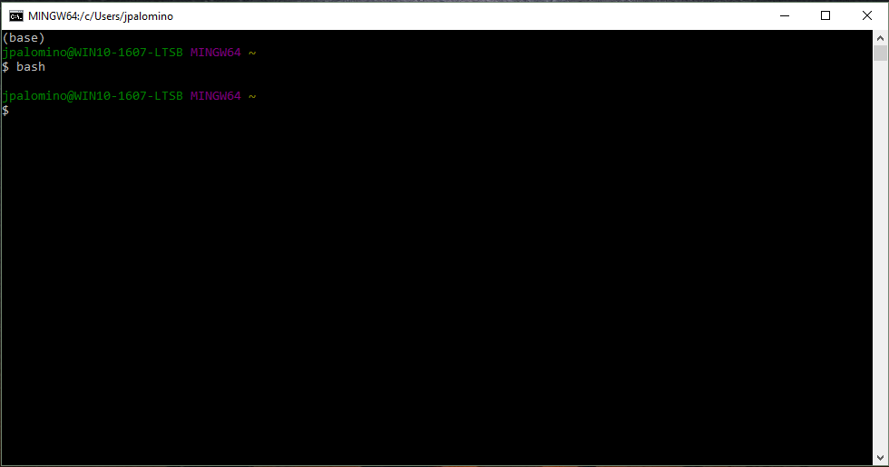

# Terminal qo'llanmasi

## 1. pwd
**Ta'rifi:** Joriy ish papkasini ko'rsatadi.  
**Vazifasi:** Terminal qaysi katalogda ekanini aniqlaydi.  
**Qachon:** Yangi buyruqdan oldin joylashuvni tekshirishda.  
**Misollar:** PowerShell: `Get-Location`; Bash: `pwd`

## 2. ls va Get-ChildItem
**Ta'rifi:** Papkadagi fayl va papkalarni ko'rsatadi.  
**Vazifasi:** Fayllar ro'yxatini ko'rib, nom va turini ajratadi.  
**Qachon:** Loyiha tarkibini tekshirganda.  
**Misollar:** PowerShell: `Get-ChildItem`; Git Bash: `ls`

## 3. cd
**Ta'rifi:** Joriy katalogni almashtiradi.  
**Vazifasi:** Terminalni boshqa papkaga o'tkazadi.  
**Qachon:** Loyiha papkasiga kirishda yoki undan chiqishda.  
**Misollar:** `cd ..`; `cd portfolio`

## 4. New-Item
**Ta'rifi:** Windows PowerShellda yangi fayl yoki papka yaratadi.  
**Vazifasi:** Bo'sh fayl yoki katalogni tez yaratadi.  
**Qachon:** Loyiha fayli yoki papkasini yaratishda.  
**Misollar:** Fayl: `New-Item README.md -ItemType File`; Papka: `New-Item src -ItemType Directory`

## 5. mkdir
**Ta'rifi:** Yangi papka yaratadi.  
**Vazifasi:** Loyiha tuzilmasida bo'limlarni ajratadi.  
**Qachon:** Resurs, test yoki kod papkasini qo'shganda.  
**Misol:** `mkdir images`

## 6. touch
**Ta'rifi:** Yangi bo'sh fayl yaratadi.  
**Vazifasi:** Windows PowerShell ekvivalenti `New-Item -ItemType File`.  
**Qachon:** Bo'sh Markdown yoki matn faylini yaratishda.  
**Misollar:** PowerShell: `New-Item test.txt -ItemType File`; Git Bash: `touch test.txt`

## 7. cp
**Ta'rifi:** Fayl yoki papkani nusxalaydi.  
**Vazifasi:** Manba faylning nusxasini yaratadi.  
**Qachon:** Ehtiyot nusxa kerak bo'lganda.  
**Misollar:** PowerShell: `Copy-Item source.txt destination.txt`; Git Bash: `cp source.txt destination.txt`

## 8. mv
**Ta'rifi:** Faylni ko'chiradi yoki nomini o'zgartiradi.  
**Vazifasi:** Fayl joylashuvini yoki nomini yangilaydi.  
**Qachon:** Faylni boshqa papkaga o'tkazganda yoki to'g'ri nom berganda.  
**Misollar:** PowerShell: `Move-Item old.txt new.txt`; Git Bash: `mv old.txt new.txt`

## 9. rm
**Ta'rifi:** Faylni o'chiradi.  
**Vazifasi:** Keraksiz faylni terminaldan olib tashlaydi.  
**Qachon:** Ma'lum, ehtiyotkorlik bilan tekshirilgan fayl keraksiz bo'lganda.  
**Misollar:** PowerShell: `Remove-Item test.txt`; Git Bash: `rm test.txt`

**Diqqat:** `rm -rf` buyrug'idan foydalanmang. O'chirishdan oldin faylni tekshiring.

## 10. cat
**Ta'rifi:** Matn fayli mazmunini ekranga chiqaradi.  
**Vazifasi:** Tuzatishsiz fayl mazmunini ko'radi.  
**Qachon:** Hujjat yoki konfiguratsiyani tekshirganda.  
**Misollar:** PowerShell: `Get-Content README.md`; Git Bash: `cat README.md`

## 11. echo
**Ta'rifi:** Matnni ekranga chiqaradi yoki faylga yozadi.  
**Vazifasi:** Oddiy natija va konfiguratsiyani qayta yo'naltirishga yordam beradi.  
**Qachon:** Skript yoki o'zgaruvchi natijasini ko'rganda.  
**Misol:** PowerShell: `Write-Output "Hello"`; Git Bash: `echo "Hello"`

## 12. grep
**Ta'rifi:** Fayl yoki chiqishda matn naqshini qidiradi.  
**Vazifasi:** Kalit so'zga mos satrlarni ajratadi.  
**Qachon:** Log yoki hujjatda ma'lum iborani topishda.  
**Misollar:** PowerShell: `Select-String "git"`; Git Bash: `grep "git" README.md`

## 13. chmod
**Ta'rifi:** Linux va Git Bashda fayl huquqlarini boshqaradi.  
**Vazifasi:** O'qish, yozish yoki bajarish huquqlarini o'rnatadi.  
**Qachon:** Skript yoki SSH faylining ruxsatini sozlaganda.  
**Misol:** `chmod +x script.sh`

## 14. clear
**Ta'rifi:** Terminal ekrani mazmunini tozalaydi.  
**Vazifasi:** Eski chiqishlarni ko'rinishdan olib tashlaydi.  
**Qachon:** Ishni yangi bosqichdan boshlashda.  
**Misol:** `clear` yoki PowerShell: `Clear-Host`

## 15. history
**Ta'rifi:** Oldin kiritilgan terminal buyruqlarini ko'rsatadi.  
**Vazifasi:** Avvalgi ishlarni qayta topadi va takrorlash imkonini beradi.  
**Qachon:** Oldingi buyruqni eslab qolish yoki ba'zi o'zgarishni tekshirishda.  
**Misollar:** PowerShell: `Get-History`; Git Bash: `history`

## Oddiy ish oqimi
1. `Get-Location` yoki `pwd` bilan joriy papkani tekshirish.
2. `Get-ChildItem` yoki `ls` bilan tarkibni ko'rish.
3. `cd loyiha` orqali loyiha papkasiga kirish.
4. `New-Item README.md -ItemType File` bilan fayl yaratish.
5. `Get-Content README.md` bilan mazmunni tekshirish.

## Savol-javob

**1. Terminal nima uchun kerak?**  
Fayllar, papkalar, Git va loyihalarni tez boshqarish uchun.

**2. PowerShellda yangi fayl qanday yaratiladi?**  
`New-Item file.txt -ItemType File`.

**3. Papka qanday yaratiladi?**  
`New-Item papka-nomi -ItemType Directory` yoki `mkdir papka-nomi`.

**4. `cd ..` nimani anglatadi?**  
Bitta yuqori papkaga chiqishni.

**5. Fayl o'chirish xavfli bo'lsa nima qilish kerak?**  
Avval fayl nomini tekshiring, `rm -rf` ishlatmang va zarur bo'lsa alohida buyruq bilan o'chiring.
